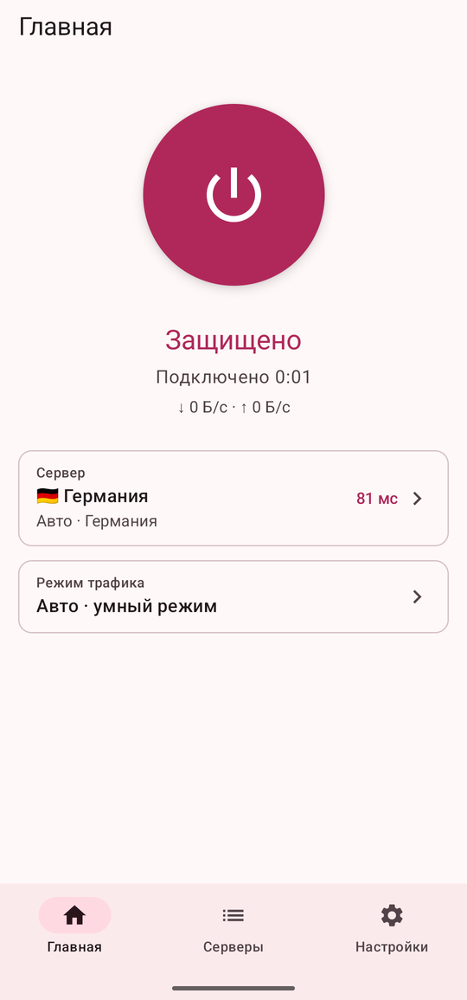
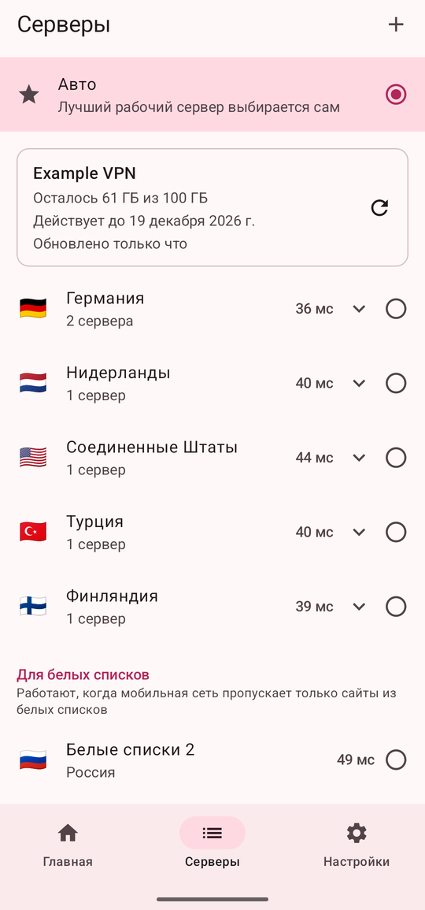
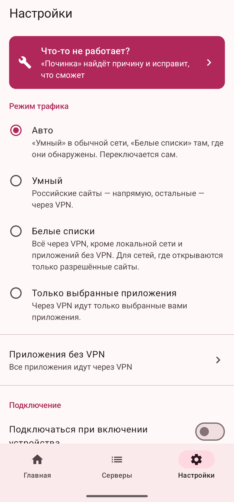
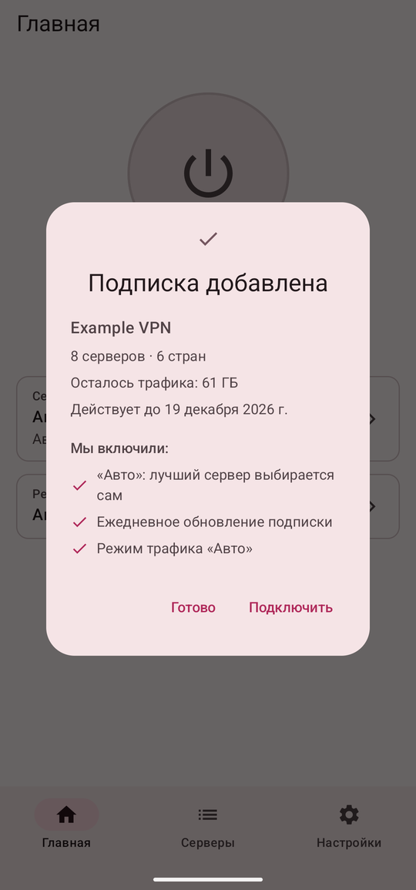

# Crown (Корона)

**Простой VPN-клиент для Android, который сам подстраивается под сеть, включая мобильные белые списки. Сборка [Throne for Android](https://github.com/throneproj/ThroneForAndroid) на ядре [sing-box](https://github.com/SagerNet/sing-box).**

> [!IMPORTANT]
> **Crown — это форк, а не Throne.** В нём собран свой набор функций для определённой аудитории: пользователей из России, которым нужен VPN «в одну кнопку» и которые сталкиваются с белыми списками в мобильных сетях. Изменения форка **не будут влиты в оригинальный Throne**, а авторы Throne его не поддерживают. С вопросами о Crown приходите в [Issues этого репозитория](https://github.com/FolkiDevv/Crown/issues), а не к авторам Throne. Если вам нужен полноценный клиент со всеми настройками, берите [оригинальный Throne for Android](https://github.com/throneproj/ThroneForAndroid).

  
  
  
  

## Чем Crown отличается от Throne

### Упрощённый интерфейс
- Три раздела — **Главная**, **Серверы**, **Настройки** — на телефоне, планшете, складном устройстве и Android TV.
- На главной одна кнопка подключения и ответы на три вопроса: защищён ли я, через какой сервер и в каком режиме.
- Добавить подписку или сервер можно одним способом: из буфера обмена, по QR-коду, ссылкой или файлом. Формат определяется сам, протокол выбирать не нужно. Скопированную ссылку приложение предлагает добавить при открытии.
- После добавления подписки сразу включаются автовыбор лучшего сервера, ежедневное обновление подписки и режим трафика «Авто». В карточке подписки видно остаток трафика и срок действия.
- Серверы подписки сгруппированы по странам, «Авто» всегда сверху. Протоколы, адреса и порты скрыты.
- Фирменная малиновая цветовая схема. На Android 12+ по умолчанию берутся цвета из обоев, это можно выключить. Есть светлая, тёмная и системная темы.
- Интерфейс на русском и английском языках.
- Классический интерфейс Throne никуда не делся: всё доступно через «Расширенный режим» в настройках.

### Режимы трафика и белые списки
- **Авто** (по умолчанию) — «Умный» в обычной сети. Если сеть пропускает только сайты из белых списков, приложение замечает это само и переключает маршрутизацию и сервер.
- **Умный** — российские сайты открываются напрямую, остальные через VPN.
- **Белые списки** — весь трафик через VPN, кроме локальной сети и приложений, исключённых из VPN.
- **Только выбранные приложения** — через VPN идут только отмеченные приложения.
- Серверы для белых списков распознаются по ключевым словам в названии и показываются отдельным разделом.

### «Починка»
Одна кнопка в настройках запускает 11 проверок по порядку: сеть, белые списки, время, частный DNS и другие VPN, DNS, подписка, доступность серверов, DNS и сайты через VPN, российские сайты напрямую, работа в фоне. Что можно исправить безопасно, приложение исправляет само. Если причину найти не удалось, можно выгрузить отчёт для поддержки VPN-сервиса. Из отчёта вырезаются пароли, ключи, UUID, адреса серверов и ссылки подписок.

### Отдельное приложение
- Свой идентификатор `dev.folki.crown`, свой ключ подписи и значок. Crown ставится **рядом** с оригинальным Throne и не конфликтует с ним.
- Обновляется внутри приложения из [релизов этого репозитория](https://github.com/FolkiDevv/Crown/releases). Preview-сборки приходят, если в настройках обновлений разрешены бета-версии.
- Запросы подписок по умолчанию уходят с User-Agent `Crown/Android/<версия Throne>`.

Ядро, протоколы, форматы подписок, маршрутизация и резервные копии — те же, что в Throne. Список протоколов и форматов есть в [README оригинала](https://github.com/throneproj/ThroneForAndroid#supported-protocols), а руководства — в [документации Throne](https://throneproj.github.io).

## Установка

APK для arm64-v8a, armeabi-v7a и x86_64 лежат в [Releases](https://github.com/FolkiDevv/Crown/releases) вместе с файлом `SHA256SUMS` для проверки. Если не знаете, какой нужен, берите arm64-v8a: он подходит почти всем современным телефонам. Нужен Android 7.0 (API 24) или новее, поддерживается Android TV.

## Разработка

Форк держится близко к upstream: новый интерфейс живёт в отдельном source set `app/src/simple/`, а правки файлов Throne ограничены проверяемым списком (`tools/diagnostics/upstream_touch_points.py`). Сборка, версии, выпуск релизов (через объявление в `fork.properties`, GitOps) и слияние upstream описаны в [CROWN.md](CROWN.md), требования — в [`openspec/specs/`](openspec/specs).

## Авторы и благодарности

Crown стоит на работе авторов **[Throne](https://github.com/throneproj)**: [Throne for Android](https://github.com/throneproj/ThroneForAndroid) и [Throne для компьютера](https://github.com/throneproj/Throne). Новости Throne — в Telegram-канале [@ThroneProj](https://t.me/ThroneProj).

А также на проектах, на которых построен сам Throne:

- [SagerNet/sing-box](https://github.com/SagerNet/sing-box)
- [XTLS/Xray-core](https://github.com/xtls/xray-core)
- [SagerNet/sing-box-dashboard](https://github.com/SagerNet/sing-box-dashboard)
- [MatsuriDayo/NekoBoxForAndroid](https://github.com/MatsuriDayo/NekoBoxForAndroid)
- [SagerNet/SagerNet](https://github.com/SagerNet/SagerNet)
- [shadowsocks/shadowsocks-android](https://github.com/shadowsocks/shadowsocks-android)

## Поддержать авторов Throne

Если Crown вам пригодился, поддержите разработчиков Throne, без которых его бы не было: через [GitHub Sponsors](https://github.com/sponsors/Mahdi-zarei) или криптовалютой на один из адресов:

| Монета | Сеть | Адрес |
|:--|:--|:--|
| **USDT** · **TRX** | TRON (TRC20) | `THR2gbWMaTZh8ACk3VYAAyNRVffvdTRikj` |
| **USDT** · **USDC** | BNB Smart Chain (BEP20) · Ethereum (ERC20) | `0x7c2dF1867f5AaEE807a835fB3c55E4de4507888A` |
| **XMR** | Monero | `4AYwwN8qMQCSUb3XfwzfrLNPMHfDme6U7CmNtQY4idCF8GtHHLG68VA3iZK867ypuKFr8J7CjXiJ96eFUA2T6aLVRUbgY3A` |

Адреса и ссылка ведут к авторам Throne, а не к автору этого форка. Они взяты из [README оригинала](https://github.com/throneproj/ThroneForAndroid#supporting-throne).

## Лицензия

[GPL-3.0](LICENSE), как у Throne.
